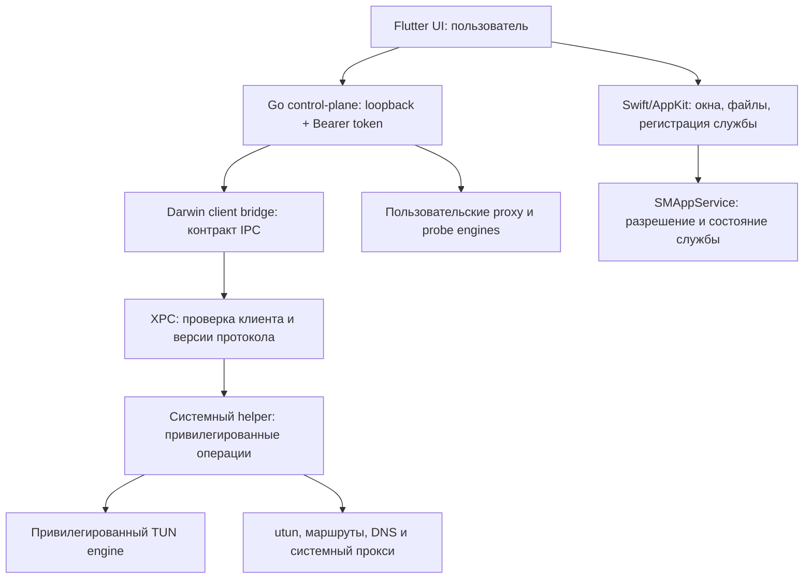

# План разработки Naga Network для macOS

Версия 2, 2026-10-18. План исправлен после проверки логики, исходников и требований платформы. Реализация начата; фактические сборки и открытые native-проверки записываются в [ходе разработки](MACOS_IMPLEMENTATION_PROGRESS.md).

Порядок конкретных действий, подшаги всех задач и критерии их завершения: [пошаговая разработка](MACOS_IMPLEMENTATION_STEPS.md).

Найденные недостатки, доказательства и внесённые исправления: [проверка плана](MACOS_PLAN_REVIEW.md). Сохранены 58 исходных ID; добавлены задачи M00.07, M03.07 и M04.07.

Цель: получить приложение для MacBook M2, которое скачивается через браузер, устанавливается из DMG и действительно проводит системный трафик через выбранный VPN. Минимальная версия **macOS 14** подтверждена пользователем.

Основа анализа — `origin/main`, коммит `d2e618a0b84fa24228c4aa92b2ead502a9cb418d`, версия приложения `1.2.9+14`. Локальная рабочая ветка на момент планирования отстаёт на девять коммитов; разработку нужно начинать от актуальной удалённой ветки с сохранением локальных изменений.

## 1. Объём и принятые решения

| Параметр | Решение |
|---|---|
| Платформа | macOS 14 и новее, ARM64; первый физический стенд — MacBook M2 |
| Установка | Скачать DMG с сайта или GitHub Releases, перенести `Naga Network.app` в `/Applications` |
| Интерфейс | Существующий Flutter-клиент; macOS runner на Swift/AppKit |
| Ядро | Существующие Go control-plane, профили, policy, подписки и проверки узлов |
| VPN | В первой рабочей beta — sing-box TUN и системный прокси; затем AmneziaWG и olcRTC |
| Привилегии | Интерфейс и основной control-plane работают от пользователя; системные операции выполняет отдельный helper |
| Установка helper | Плановый путь — `SMAppService`/LaunchDaemon, после проверки требований подписи на этапе M00 |
| Первый канал сборок | Тестовый DMG; допустимость ad-hoc подписи для всей установки проверяется в M00 |
| Публичный подписанный канал | Developer ID, notarization и проверка скачанного DMG на чистом Mac |
| Обновление первой beta | Проверка версии, ручная установка DMG и согласованная замена helper; установка через Linux updater исключается |
| Автоматическое обновление | Отдельный этап для подписанного канала; транзакция app/helper и восстановление проверяются прототипом M00.07 |

Первый вариант рассчитан на распространение вне App Store, без App Sandbox. Entitlements для hardened runtime определяются отдельно. NetworkExtension и распространение через App Store остаются отдельным направлением после работающего desktop-клиента.

Flutter предоставляет macOS toolchain через Xcode; сборочная среда должна быть macOS. Можно использовать ARM64 runners GitHub Actions; стандартные runners бесплатны для публичного репозитория. Это позволяет вести разработку с Linux. [Flutter](https://docs.flutter.dev/platform-integration/macos/setup), [GitHub Actions](https://docs.github.com/en/actions/reference/runners/github-hosted-runners).

Скачивание DMG сохраняет проверки Gatekeeper. Пользовательское разрешение запуска тестового приложения и регистрация системного helper требуют самостоятельных проверок. Apple DTS отдельно указывает на проблемы ad-hoc подписанных helper в `SMAppService`; беспроблемную установку полноценного VPN без Apple-issued signing identity заранее не обещаем. [Gatekeeper](https://support.apple.com/en-us/102445), [Apple DTS о подписи helper](https://developer.apple.com/forums/thread/799910).

## 2. Что уже есть и что требуется добавить

| Область | Состояние в проверенном коде | Изменение для macOS |
|---|---|---|
| Flutter UI | Есть `app/lib`, Linux/Windows runners; `app/macos` отсутствует | Создать macOS runner и native channels |
| HTTP API | `ControlPlaneClient` использует loopback и Bearer token | Переиспользовать API, добавить управляемый запуск backend и передачу endpoint/token |
| Хранение | `core/storage/paths.go` и Dart token loader используют Linux-пути для Darwin | Согласовать каталоги macOS, миграцию и права |
| TUN preflight | `core/control/preflight_other.go` возвращает ошибку неподдерживаемой платформы | Добавить Darwin preflight и проверку helper |
| Адаптация sing-box | `tun_other.go` возвращает конфиг без изменений | Добавить Darwin-адаптацию, utun и platform capabilities |
| Подготовка конфига | `adapter.go` вызывает `NormalizeLinuxConfig`; `compat.go` меняет TUN stack/strict_route, resolver готовится отдельно | Разделить общую нормализацию и platform-specific операции; Validate/Start проверяют одни и те же итоговые данные |
| Привилегированный запуск | `start_other.go` запускает обычный процесс пользователя | Добавить Darwin transport к helper и владение runtime-сессией |
| Замеры без VPN | `StartProbe` переиспользует `Start`, `runtime_probe.go` запускает отдельный временный runtime | Отделить пользовательские probe/proxy процессы от системной TUN-сессии |
| Файлы и engine API | `adapter.go` создаёт config/rule-set/log paths и loopback Clash API с secret в пользовательском процессе | Определить передачу данных, права и ограниченные операции между пользовательским backend и привилегированным engine |
| DNS | `dns_platform_other.go` предоставляет пустую реализацию | Добавить настройку и восстановление системных resolver settings |
| Системный прокси | `system_proxy_other.go` возвращает `nil` | Добавить Darwin manager с сохранением предыдущих настроек |
| Класс сети | `cmd/naga-control` использует `network.LinuxClass`/NetworkManager | Добавить Darwin detection и события изменения физической сети |
| Файлы конфигурации | `config_file_picker.dart` обрабатывает Linux и Windows | Добавить `NSOpenPanel` через native channel |
| olcRTC | `session_other.go` возвращает `routing is not supported` | Добавить Darwin routes/DNS и совместимость hev с utun |
| Обновление | `detectInstallKind()` возвращает `linuxDev` для macOS | Ввести явный macOS install kind и отдельный установочный путь |
| Поставка | Есть scripts/workflows Linux и Windows | Добавить macOS runtime, app, DMG и проверки |

В `scripts/linux/build-runtime.sh` закреплены sing-box `1.13.20`, source commit `56f91dfeabd6f4edbd437dfcc1e5b0ebc856b778`, olcRTC `7f849e08022ac4ce6dcdb1a49ad5560446daca1f` и hev `dec294e1402ebb0b2d78d1f6efebaba81511e960`. macOS-сборки должны учитывать эти версии и существующие исправления зависимостей. Доступность Darwin-сборок всех компонентов ещё нужно подтвердить.

## 3. Архитектура процессов

Транспорт между Go и XPC подтверждается прототипом M00. Плановый вариант — небольшой пользовательский Swift client bridge с фиксированным протоколом, управляемый Darwin-адаптером Go и сохраняющий XPC-соединение на время жизни backend. У helper ограниченные операции: состояние, начало/остановка принадлежащей клиенту сессии, сетевые изменения и восстановление; при необходимости — типизированные операции выбора узла, probe и статистики привилегированного engine. Профили, подписки и обычный HTTP API остаются в пользовательском процессе.

Helper принимает структурированные запросы, проверяет клиента, UID и совместимость версий. Бинарники и привилегированные рабочие каталоги проверяются до запуска; пользовательские пути к произвольным исполняемым файлам не входят в контракт. Конфигурация, переданная из профиля, проходит проверку разрешённых операций и файловых путей.

Подпись bridge подтверждает executable, но сама по себе не подтверждает полномочия приславшего ему запрос процесса. M00/M03 определяют bootstrap backend → bridge, политику допустимых клиентов одного UID и привязку session authority; проверяют обе стороны XPC. Реализация использует публичные API, доступные на macOS 14.0; недоступные на 14.0 новые API требуют отдельного fallback. [NSXPCConnection](https://developer.apple.com/documentation/foundation/nsxpcconnection/setcodesigningrequirement(_:)), [Apple DTS о проверке XPC peer](https://developer.apple.com/forums/thread/681053).

Режимы исполнения различаются явно: системный TUN использует helper; обычный proxy engine и временные замеры работают от пользователя. Изменение системных proxy settings по-прежнему выполняет helper. Ограничение одной активной VPN-сессии относится к сетевым мутациям, а временные probes имеют отдельные лимиты, каталоги и cleanup.

На компьютере одновременно действует одна VPN-сессия Naga. Закрытие окна оставляет приложение в строке меню; команда «Выйти» завершает сессию и восстанавливает сеть. Выход пользователя из системы и потеря связи с control-plane также должны приводить к согласованной очистке с ограниченным временем ожидания.

Первая beta использует fail-open при сбое: сессия завершается, сеть возвращается к обычной работе, статус connected снимается. Kill switch не заявляется до отдельной реализации/проверки. При недоступном либо запрещённом helper восстановление может требовать повторного admin-разрешения; UI показывает recovery pending и сохраняет журнал, а не сообщает об успешной очистке. Crash helper и отключение службы проверяются отдельно; право на её запуск не заменяет crash-restart policy.

`SMAppService` управляет встроенными helper и регистрирует службу с учётом разрешения пользователя; структуру bundle и plist проверяем по документации Apple. [SMAppService](https://developer.apple.com/documentation/servicemanagement/smappservice), [пример Apple DTS](https://developer.apple.com/forums/thread/802443).

## 4. Очередь работ и зависимости

Все чекбоксы ниже относятся к будущей реализации. Этап закрывается после выполнения задач и подтверждения указанного результата.

| Этап | Зависит от | Проверяемый результат |
|---|---|---|
| M00. Проверка технических предпосылок | —; bootstrap runner входит в M00.01 | Отдельные результаты сборки, TUN, установки и замены helper |
| M01. macOS runner и CI | Runner: M00.01; встраивание runtime: M00.02.01/.02; архитектура может быть provisional | Приложение запускается на ARM64, CI выдаёт `.app` |
| M02. Backend и platform integration | Runner M01.01–M01.02, пользовательский backend из M00.02.01; остальной CI развивается параллельно | UI работает с пользовательским Go backend и профилями |
| M03. Helper и IPC | M02; M00.04–M00.06 для подтверждённого install/auth path | Разрешения, запуск/остановка и восстановление управляются из приложения |
| M04. sing-box TUN и DNS | M02–M03 | Системный TCP/UDP-трафик и DNS проходят выбранным маршрутом |
| M05. Системный прокси и desktop UX | M02–M04 | Работают оба режима, меню, импорт и сетевые переходы |
| M06. AmneziaWG и olcRTC | M03–M05 | Подтверждена работа дополнительных движков на macOS |
| M07. DMG и установка | M01–M05; M06 для полной поставки | Полный пакет устанавливается на чистый Mac без dev-инструментов |
| M08. Приёмка на M2 | M07, соответствующие движки M06 | Есть воспроизводимые результаты VPN, восстановления и установки |
| M09. Подпись, обновление и публичный канал | Проверенный тестовый M07/M08; signing inputs; M00.07 до автообновления | Подписанный DMG; отдельная готовность автоматического обновления |

M07 первоначально закрывается для тестового канала и не зависит от M09. Подписанный пакет заново собирается теми же scripts внутри M09, затем проходит M09.02 и применимые сценарии M08 с новым digest. Для ручной замены app/helper нужен результат M00.07 до соответствующей приёмки M07.06. Неудача прототипа обновления не блокирует первую чистую установку, но блокирует объявление проверенного обновления.

Таблица задаёт входы работ, а приёмка учитывается по каналам DEV/SIGNED. Необязательная подписанная ветвь задачи не становится зависимостью разработки пользовательского backend или dev-сборки; release gate проверяет необходимые строки матрицы, а не формальное закрытие всех поздних ветвей этапа.

Нет обязательной зависимости UI/CI от доступности M2 или Developer ID: пока физические/signing проверки открыты, можно собирать и проверять пользовательские части. Пользовательская VPN-beta допускается только после обязательных системных сценариев M00/M03/M08.

### M00. Проверить предпосылки до основной разработки

- [ ] **M00.01.** Зафиксировать исходный commit, версию macOS на M2, доступ к macOS runner, Xcode, Flutter и Go. Начать ветку от актуальной `main` с сохранением работы; поднять минимальный bootstrap macOS job для проверок M00 до полного CI M01.
- [ ] **M00.02.** Проверить сборку `naga-control`, закреплённого sing-box, olcRTC и hev для `darwin/arm64`; записать необходимые build tags, CGO, SDK и native-библиотеки. Успех каждого компонента учитывать отдельно.
- [ ] **M00.03.** На M2 запустить минимальный sing-box TUN с тестовым профилем и явным повышением прав для прототипа; проверить utun, один внешний запрос, DNS и возврат сети после остановки.
- [ ] **M00.04.** Сделать минимальное `.app` с helper: зарегистрировать службу, выдать/отклонить разрешение, перезапустить приложение и ОС, удалить службу. Проверить отдельно доступную Apple-issued identity и ad-hoc вариант.
- [ ] **M00.05.** Проверить путь Go → Swift bridge → XPC → helper, аутентификацию клиента и сообщение об отказе. Определить способ привязки к клиенту для каждого режима подписи.
- [ ] **M00.06.** Записать архитектурное решение: доступный вариант установки, требования сертификата, размещение runtime и модель восстановления. Если доступна только ad-hoc подпись и штатная регистрация не работает, описать отдельную локальную dev-установку с явной admin-авторизацией; статус пользовательской установки оставить неподтверждённым до рабочего решения.
- [ ] **M00.07.** Проверить на минимальных версиях A/B замену приложения с зарегистрированным helper: остановку сессии, unregister/register, несовместимый IPC, отмену и восстановление. Зафиксировать подписанный и dev-пути отдельно; выбрать подтверждённый порядок ручного/будущего автоматического обновления.

Результат: короткий отчёт с командами, версиями и фактическими исходами; определён путь к пользовательской установке. Сборка UI может продолжаться при отсутствии сертификата, но неподтверждённый helper остаётся открытой зависимостью VPN-beta.

### M01. Создать приложение macOS и сборочный CI

- [ ] **M01.01.** Создать `app/macos` штатным Flutter scaffold, сохранить существующие платформы, настроить deployment target macOS 14, имя, bundle ID, иконку и версии из `app/pubspec.yaml`.
- [ ] **M01.02.** Настроить ARM64 для runner, Go и всех вложенных бинарников; проверять Mach-O и зависимости средствами `file`, `lipo` и `otool`. Работа на M2 проверяется без Rosetta.
- [ ] **M01.03.** Настроить entitlements для выбранного внешнего канала поставки. Проверять Debug/Release отдельно; учитывать зависимости Flutter при hardened runtime.
- [ ] **M01.04.** Добавить `.github/workflows/macos-dmg.yml` с зафиксированной macOS ARM64 image, совместимым Xcode и версиями Flutter/Go из проекта. Поддержать ручной `source_ref`; публикацию отделить от сборки.
- [ ] **M01.05.** Добавить native Go checks, Dart analysis, Flutter tests и сборку `.app`. Адаптировать Linux-зависимые тесты по применимости, сохранив общий regression coverage.

Результат: воспроизводимый CI-артефакт `.app`; на M2 открывается основной интерфейс. На этом этапе работающий VPN ещё не заявляется.

### M02. Подключить пользовательский backend и интеграцию macOS

- [ ] **M02.01.** Запускать встроенный `naga-control` из native host с ограниченными таймаутами, readiness handshake, endpoint и версией. Учесть занятый порт и повторный запуск приложения.
- [ ] **M02.02.** Передавать endpoint/token в Dart явно, до первых API-запросов. Сохранить обязательную авторизацию loopback API и закрыть браузерный доступ без разрешённого origin.
- [ ] **M02.03.** Согласовать Go и Dart на `~/Library/Application Support/Naga Network`; отделить cache/logs и системное состояние helper. Профили и token доступны владельцу; миграция старых dev-путей сохраняет данные.
- [ ] **M02.04.** Добавить Darwin capability/status API: backend, helper, движки, TUN, proxy, signing/build channel. Неподдерживаемые операции возвращают предметную ошибку до изменения сети.
- [ ] **M02.05.** Добавить native выбор JSON/CONF через `NSOpenPanel`, отмену выбора и существующий лимит размера; проверить импорт подписки, список узлов и сохранение настроек после перезапуска.
- [ ] **M02.06.** Добавить Darwin определение физического интерфейса и сетевых изменений. Исключить utun из классификации, учесть Wi-Fi, Ethernet и раздачу с телефона.

Результат: пользователь может открыть приложение, импортировать профиль, выбрать узел и получить диагностику backend без ручного запуска процессов.

### M03. Реализовать helper, IPC и восстановление

- [ ] **M03.01.** Реализовать регистрацию, проверку статуса, повторное разрешение и unregister helper по решению M00. Показать состояния «нужно разрешение», «отказано», «готово», «несовместимая версия».
- [ ] **M03.02.** Ввести версионированный IPC-контракт: session ID, owner UID, start/stop/status, события завершения. Проверять audit identity клиента и отказывать второму владельцу активной сессии.
- [ ] **M03.03.** Ограничить запуск закреплёнными компонентами приложения, проверять их целостность/идентичность, рабочие каталоги и конфиг. Исключить подмену runtime через `PATH`, environment и writable symlink.
- [ ] **M03.04.** Добавить Darwin process adapter в sing-box и поддержать `startedProcess`: readiness, stop, timeout, crash, exit status и журналы. Исправить build constraints пересекающихся `*_other.go`.
- [ ] **M03.05.** Ввести журнал изменений сети с session ownership, сохранением исходного состояния до мутации и идемпотентным восстановлением. При восстановлении учитывать изменения, сделанные системой или другим приложением после старта Naga.
- [ ] **M03.06.** Обработать потерю Go backend, принудительное завершение UI/engine, logout, reboot, отзыв разрешения helper и отмену запуска. Зафиксировать порядок завершения дочерних процессов и cleanup при следующем запуске.
- [ ] **M03.07.** Определить передачу окончательного конфига, rule-set assets, stdout/stderr и статистики через границу прав. Проверить root-owned snapshots и защиту от подмены; ограничить engine API так, чтобы клиент не получал произвольную привилегированную перезагрузку конфига или доступ к файловой системе.

Результат: цикл register → start → stop → unregister проходит с ожидаемыми правами и очисткой. Запрос другого клиента или подменённого бинарника отклоняется до запуска engine.

### M04. Добавить sing-box TUN, маршруты и DNS

- [ ] **M04.01.** Добавить Darwin preflight и `tun_darwin.go`: выбор utun без жёстко заданного индекса, адреса, MTU, адаптация импортированных конфигураций. Обновить build constraints общих реализаций.
- [ ] **M04.02.** Определить единственного владельца каждого маршрута: sing-box либо helper. Настроить обход VPN endpoint и выход на физический интерфейс, чтобы исключить захват собственного транспорта в туннель.
- [ ] **M04.03.** Реализовать Darwin DNS manager на системных resolver settings с восстановлением исходных значений. Проверить bootstrap разрешение имени сервера, DNS через туннель и согласование с правилами direct/bypass.
- [ ] **M04.04.** Проверить весь pipeline `NormalizeLinuxConfig` → Darwin adaptation → resolver/API preparation → validation → запуск. Разделить общие и Linux-specific преобразования; Validate/Start должны проверять один итоговый конфиг. Новые параметры sing-box не переносить в закреплённый runtime без проверки и миграции.
- [ ] **M04.05.** Поддержать IPv4/IPv6 и определить поведение для профиля без IPv6. Проверить отсутствие нежелательного обхода туннеля, LAN/RU/provider rules и восстановление при частичной ошибке настройки.
- [ ] **M04.06.** Увязать готовность туннеля с реальным engine и сетевой проверкой. Проверить ручной выбор, автовыбор, замеры задержки и отмену подключения после изменения маршрутов.
- [ ] **M04.07.** Разделить запуск TUN, системного proxy и временных probe runtimes по нужным привилегиям. Проверить массовые замеры без VPN/helper, их отмену и совмещение с управлением VPN без лишней системной сессии или DNS-мутаций.

Результат: на M2 подтверждены TCP, UDP, DNS, внешний адрес, правила обхода и возврат сети. Сначала проверяется один рабочий VLESS/Reality профиль, затем доступные стенды Hysteria2, TUIC, Shadowsocks, Trojan и VMess; результат каждого протокола записывается отдельно.

Официальный sing-box поддерживает TUN на macOS. Его актуальная документация включает параметры более новых версий, поэтому совместимость определяется закреплённым runtime. [Документация TUN](https://sing-box.sagernet.org/configuration/inbound/tun/).

### M05. Системный прокси и поведение desktop-клиента

- [ ] **M05.01.** Добавить `system_proxy_darwin.go`: HTTP/HTTPS/SOCKS, bypass, исходные состояния proxy/PAC, выбор активного сетевого сервиса. Сохранять исходные значения и восстанавливать только изменения Naga.
- [ ] **M05.02.** Проверить переходы TUN ↔ proxy ↔ stopped и смену физической сети во время подключения. Отказ системного разрешения завершает операцию без частично настроенного подключения.
- [ ] **M05.03.** Реализовать строку меню через `NSStatusItem`: состояние, подключение, отключение, открыть окно и выйти. Подключить существующий Flutter tray contract и macOS клавиатурные команды.
- [ ] **M05.04.** Обработать закрытие окна, повторное открытие из Dock, sleep/wake, смену Wi-Fi и Ethernet. После пробуждения переопределять физический интерфейс и доступность endpoint.
- [ ] **M05.05.** Добавить экспорт диагностик с редактированием секретов и понятные ошибки разрешений, helper и engine. Непроверенные функции, включая отдельные виды app bypass/kill switch, отражать в capabilities.

Результат: оба заявленных режима управляются из UI; штатный выход восстанавливает сеть, закрытие окна сохраняет доступ к подключению через строку меню.

### M06. AmneziaWG и olcRTC

- [ ] **M06.01.** Проверить сборку и исполнение AmneziaWG userspace/netstack sidecar на Darwin: импорт, handshake, readiness и SOCKS endpoint.
- [ ] **M06.02.** Подключить AmneziaWG к Darwin datapath, проверить UDP endpoint bypass, DNS, маршруты и cleanup. Применить ту же модель владения сессией и сетевыми изменениями.
- [ ] **M06.03.** Подтвердить ARM64-сборку olcRTC и hev с закреплёнными изменениями зависимостей, включая native libraries и формат utun-конфигурации.
- [ ] **M06.04.** Добавить `session_darwin.go` и необходимые Darwin tunnel adapters: захват текущей сети, обход room endpoint, установка маршрутов, DNS и восстановление. Убрать Darwin из пересекающегося `session_other.go`.
- [ ] **M06.05.** Проверить переходы sing-box ↔ AmneziaWG ↔ olcRTC: остановка предыдущего datapath, один активный engine, таймаут комнаты, падение hev, UDP и повторное подключение.

Результат: каждый движок имеет собственный подтверждённый connect/traffic/stop сценарий на M2. До этого импорт соответствующего профиля не означает поддержку подключения; capability и release notes должны указывать фактическое состояние.

### M07. Собрать полный DMG и проверить установку

- [ ] **M07.01.** Добавить `scripts/macos/build-runtime.sh`, `build-app.sh`, `build-dmg.sh` и `check-package.sh`. Сохранить pins, security patches и лицензии компонентов; записывать manifest исходников и сборочного окружения.
- [ ] **M07.02.** Разместить runner, backend, helper, bridge, engines, plist и ресурсы внутри app bundle по принятой структуре. Подтвердить все executable paths и доступ к ресурсам после переноса приложения.
- [ ] **M07.03.** Собирать `NagaNetwork-<ver>-macos-arm64.dmg` с приложением и ссылкой на `/Applications`. Проверять deployment target всех компонентов, ARM64, executable bits и отсутствие зависимостей на dev-каталоги/Homebrew.
- [ ] **M07.04.** Выполнить подпись и проверку тестового пакета без зависимости от M09. Встроенный build manifest формировать до внешней подписи; release manifest с окончательным digest DMG хранить снаружи пакета. Подписанный вариант этих scripts используется внутри M09.
- [ ] **M07.05.** Пройти установку через настоящий браузер с сохранённым quarantine: скачать, открыть DMG, перенести приложение, запустить, разрешить helper. Запуск с read-only DMG должен предложить установку в `/Applications` до системных изменений.
- [ ] **M07.06.** Реализовать обновление первой beta через отдельный macOS install kind и ручную установку проверенного DMG. Проверить точное имя ассета, digest и отсутствие перехода в Linux install path.
- [ ] **M07.07.** Добавить удаление helper с остановкой VPN и восстановлением сети; отдельно предложить удаление пользовательских профилей. Проверить повторную установку и перенос приложения в Корзину после удаления службы.

Результат: DMG содержит всё необходимое; на чистом M2 установка и подключение проходят без Flutter, Go, Xcode и ручного запуска engine. Способ выдачи системного разрешения соответствует подтверждённому решению M00.

### M08. Приёмка на настоящем M2

- [ ] **M08.01.** Подготовить сценарии и таблицу результатов с SHA-256 DMG, source commit, macOS build, hardware и версией каждого engine. Минимальную macOS 14 и актуальную стабильную macOS проверять раздельно.
- [ ] **M08.02.** Проверить чистую установку, повторную установку, запуск после reboot, отказ в разрешении, повторную выдачу разрешения и удаление службы.
- [ ] **M08.03.** Прогнать импорт → выбор → connect → TCP/UDP/DNS → stop для заявленных протоколов и режимов. Проверить внешний IP, IPv6, LAN bypass, правила и работоспособность приложений вне браузера.
- [ ] **M08.04.** Проверить обрыв сети, смену Wi-Fi/Ethernet, hotspot, sleep/wake, отмену подключения, падение UI/backend/helper/engine и освобождение ресурсов после повторных соединений.
- [ ] **M08.05.** Сверить routes, resolver и proxy до/после остановки и сбоев. Проверить отключение Naga при активном стороннем VPN и понятное поведение при конфликте.
- [ ] **M08.06.** Выполнить продолжительный прогон на M2: CPU, память, нагрузка в простое, передача данных, закрытая крышка/пробуждение и отсутствие накопления процессов/utun.

Результат: есть отчёт приёмки. Компиляция на macOS runner учитывается отдельно от работы VPN; недоступный физический сценарий остаётся `UNAVAILABLE` с конкретной причиной.

### M09. Подписанный публичный канал и автообновление

- [ ] **M09.01.** Настроить Developer ID, signing identity приложения/helper, hardened runtime, timestamps, notarization и stapling. Проверять подписи вложенных executables и итоговый артефакт средствами macOS. Сертификаты и ключи хранятся вне git.
- [ ] **M09.02.** Повторить browser install с подписанным DMG на чистом M2. Проверить Gatekeeper, регистрацию helper, reboot и отсутствие зависимости от локальных dev-разрешений.
- [ ] **M09.03.** Подключить Sparkle 2 как плановый вариант после прототипа M00.07; подтвердить installer lifecycle для helper, закрепить версию, appcast, подпись и интеграцию с кнопкой обновления. При неподтверждённой интеграции сохранить ручной подписанный канал.
- [ ] **M09.04.** Согласовать обновление приложения и helper по результату M00.07, включая совместимость соседних версий IPC. Сохранить рабочий пакет и обратимый формат данных; отдельно доказать автоматический откат либо описать проверенную ручную переустановку. Встроенная транзакция app/helper со стороны Sparkle не предполагается.
- [ ] **M09.05.** Проверить настоящее обновление между двумя подписанными версиями с сохранением профилей/настроек, а также отказ установки артефакта неверной архитектуры или подписи.
- [ ] **M09.06.** Подготовить `docs/platforms/MACOS.md`, обновить платформенные README и `RELEASES.md`, приложить manifest, `SHA256SUMS.txt` и результаты M08. Публичную поддержку macOS объявлять по фактически пройденной матрице.

Developer ID и notarization относятся к распространению вне App Store. Для обновления выбран существующий macOS framework Sparkle; совместимость с Flutter и lifecycle helper подтверждается на этом этапе. [Apple](https://developer.apple.com/developer-id/), [Sparkle](https://sparkle-project.org/documentation/).

## 5. Карта предполагаемых изменений

Новые пути ниже — планируемые; окончательную структуру фиксирует M00.

| Область | Пути |
|---|---|
| macOS host, channels, ServiceManagement/XPC | `app/macos/`, возможный `native/macos/` для helper и bridge |
| Запуск control-plane и диагностика | `cmd/naga-control/`, `core/control/serve_local.go`, `app/lib/control_plane_client.dart` |
| Пути и token | `core/storage/paths.go`, `app/lib/control_plane_token_io.dart` |
| Привилегированный runtime и файлы | Darwin host adapter, `core/engine/singbox/start_darwin.go`, `adapter.go`, `process.go`, корректировка `start_other.go` |
| Нормализация, resolver и probe | `core/engine/singbox/compat.go`, `compat_dns.go`, `adapter.go`, `core/control/runtime_probe.go` |
| TUN/DNS/proxy | `core/control/preflight_darwin.go`, `dns_platform_darwin.go`, `system_proxy_darwin.go`, `core/engine/singbox/tun_darwin.go` |
| Build constraints | Соответствующие `preflight_other.go`, `dns_platform_other.go`, `system_proxy_other.go`, `tun_other.go`, `start_other.go`, `session_other.go` |
| Физическая сеть | `core/network/`, внедрение платформенного detector в control-plane |
| Дополнительные движки | `core/engine/amneziawg/`, `core/engine/olcrtc/`, `core/control/runtime_awg.go`, `core/control/olc_tun.go` |
| Интерфейс, импорт и обновления | `app/lib/main.dart`, `config_file_picker.dart`, `app_update.dart` и native channels |
| Поставка и CI | `scripts/macos/`, `packaging/macos/`, `.github/workflows/macos-dmg.yml` |
| Документация и приёмка | `docs/platforms/MACOS.md`, `docs/platforms/RELEASES.md`, `docs/README.md`, README двух языков, отчёт native-проверок |

## 6. Проверки и критерии готовности

| Уровень | Что подтверждает | Где выполняется |
|---|---|---|
| Dart/Go unit tests | Контракты, пути, capability checks, сценарии ошибок, ownership/restore logic | Доступные host-платформы; Darwin-specific tests на macOS |
| macOS CI | Сборка `.app`/DMG, native-тесты, архитектура, состав bundle и подписи | macOS ARM64 runner |
| macOS integration | Helper registration, IPC identity, процессы, маршруты, DNS и proxy | macOS стенд с нужными разрешениями |
| Browser install | Quarantine/Gatekeeper, перенос в Applications, первое разрешение helper | Чистый Mac без developer tooling |
| M2 end-to-end | Фактический VPN-трафик, sleep/wake, восстановление и стабильность | Настоящий MacBook M2 |
| Upgrade | Обновление между двумя выпущенными пакетами и согласование helper | M2, затем доступная дополнительная версия macOS |
| Regression | Сохранение работы Linux/Windows и общих клиентских контрактов | Существующие CI jobs после изменений общих компонентов |

Для реестра результатов использовать `TODO`, `PASS`, `FAIL`, `UNAVAILABLE`, `N/A`, связывать результат с ID задачи и артефактом. Тесты добавлять для контрактов и существенных ветвей поведения; простые изменения документации и оформления не требуют отдельного тестового кода.

Контрольные точки:

1. **Прототип:** подтверждены utun и путь установки helper; ограничения signing зафиксированы.
2. **Приложение:** UI, профиль и Go backend работают из одного `.app`.
3. **Рабочая beta DMG:** пройдены M00–M05, M07 и применимые сценарии M08; есть реальный системный VPN на M2 и подтверждённая установка. Поддержка дополнительных движков объявляется по M06.
4. **Полная поддержка движков:** пройдены M06 и соответствующие native-сценарии M08.
5. **Подписанный публичный канал с ручной установкой:** пройдены M09.01, M09.02, M09.06 и ручная замена app/helper; подписанный артефакт прошёл собственную приёмку.
6. **Автоматическое обновление:** дополнительно пройдены M09.03–M09.05 между двумя реальными версиями; подтверждено согласование helper и способ восстановления при отказе.

Для каждого канала заранее фиксируется обязательная матрица протоколов/режимов и стендов. Обязательная строка `FAIL`, `TODO` или `UNAVAILABLE` блокирует соответствующее заявление о готовности; `N/A` требует обоснования, а сокращение объёма отражается в capabilities/release notes. Другой optional engine не блокирует beta с явно ограниченной поддержкой. Одних числа шагов, компиляции или длительности теста для релизного решения недостаточно.

## 7. Риски и внешние зависимости

| Зависимость | Когда проверяем | Действие при ограничении |
|---|---|---|
| Apple-issued signing identity для штатной установки helper | M00 | Зафиксировать реальное требование до обещания установки без платной учётной записи; dev-установку учитывать отдельно |
| Сборка закреплённых sing-box/olcRTC/hev на ARM64 | M00, M06 | Исправить конкретный компонент либо явно ограничить поддержку движка в beta |
| API и параметры новее sing-box 1.13.20 | M00, M04 | Проверять по закреплённому исходнику; обновление runtime выполнять отдельным изменением с regression checks |
| Физический M2, macOS 14 и актуальная стабильная macOS | M00, M08 | Отдельно записывать непроверенные версии и сценарии; CI не заменяет native-приёмку |
| Тестовые серверы и профили разных протоколов | M04, M06 | Использовать выделенные конфиги; секреты передавать вне git и исключить из отчётов |
| Замена приложения при активной службе | M07, M09 | Проверить остановку, переустановку helper, совместимость IPC и восстановление предыдущей версии |

Очередь реализации начинается с M00: он снимает главные неопределённости сборки и привилегий. Первой поставляемой целью служит рабочий ARM64 DMG с sing-box TUN на M2; следующие этапы расширяют поддержку движков и добавляют подписанный канал обновлений.
